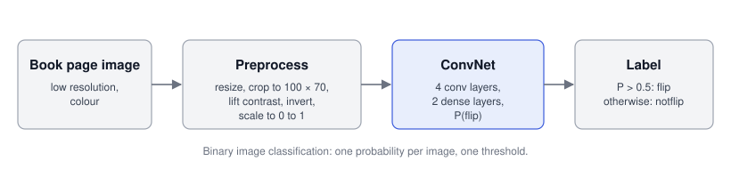
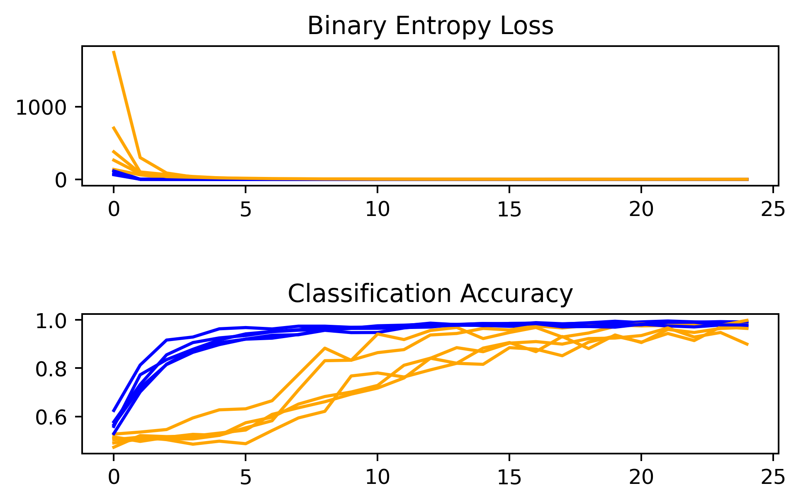

# computer-vision-document-motion-convnet

Binary image classification with a convolutional neural network (ConvNet):
given a low-resolution image of a document, predict whether the page is
`moving` or `still`.

## The problem

Digitizing a book usually means photographing it one page at a time. A
book-digitization app can take that work off the user: while they go through
the book, it watches a low-resolution preview, captures each page at full
resolution and turns the scans into digital text. To capture at the right
moment, the app has to decide, image by image, whether the page is still
moving or has come to rest. If it captures too early, the scan is blurred. If
it waits too long, digitizing a whole book becomes slow.

That decision is a two-class image classification problem. I worked on it in
2022 as an applied-ML residency project, building a computer-vision proof of
concept. I trained it on 2,392 labelled images and tested it
on a separate set of 597.

## Approach



**Figure 1.** *From input image to label.* Each image is resized, cropped,
contrast-adjusted and inverted. A ConvNet then outputs the probability that
the page is moving, and probabilities above 0.5 count as `moving`.

- OpenCV preprocessing turns each image into a 100 × 70 × 3 array and makes
  page edges and text stand out.
- The ConvNet has four convolution layers and two dense layers, trained with
  binary cross-entropy and Adam.
- I evaluated it with 5-fold cross-validation on the training set, then scored
  a final model on the held-out test set.

This repository packages that 2022 method as a Python library. It keeps the
same preprocessing, network and training procedure. Through Keras 3, it runs
on TensorFlow, JAX or PyTorch, and it adds a hand-written PyTorch version of
the network, a command-line tool for training and batch prediction, and a
model card.

## Results (2022)

| | Accuracy | Precision | Recall | F1 |
|---|---|---|---|---|
| Held-out test set, all 597 images | **0.98** | | | |
| `moving` (290 images) | | 0.99 | 0.98 | 0.98 |
| `still` (307 images) | | 0.98 | 0.99 | 0.98 |
| 5-fold cross-validation on the 2,392 training images | **96.2%** (std 3.3) | | | |

- The five fold accuracies were 96.9%, 98.1%, 99.8%, 96.4% and 90.0%.
- The test set was a separate folder that the model never saw while training.
  It is the number I trust most, for the reason given under
  [Limitations](#limitations).
- I also tried a second approach on video sequences, using features from a
  pretrained VGG16 network. It reached 54% accuracy and recalled only 11% of
  still images, so I dropped it.



**Figure 2.** *Learning curves from the 2022 cross-validation run*, as the
notebook drew them. Blue is training and orange is validation, one line per
fold, over 25 epochs. Validation accuracy lags for about ten epochs before it
catches up. [Design notes](#design-notes) explains the spike in validation
loss at the first epoch.

## What this project shows

- I wrote the computer-vision pipeline end to end: OpenCV preprocessing, a
  ConvNet sized for this input, k-fold cross-validation and a held-out test
  report.
- The Keras 3 model runs unchanged on TensorFlow, JAX and PyTorch, and CI tests
  it on all three.
- The hand-written PyTorch version is checked against the original. Given the
  same weights, it makes the same predictions to within 0.00001
  ([tests/test_torch_model.py](tests/test_torch_model.py)).
- The model is packaged for use, with a YAML training config, a dated run
  folder per training run (config, metrics and model file), a `doc-motion`
  command-line tool, a Docker image for batch prediction and a
  [model card](MODEL_CARD.md).
- The code has 39 tests on synthetic images, a 95% branch-coverage gate in CI,
  and ruff and mypy checks.

## Install

```bash
pip install torch --index-url https://download.pytorch.org/whl/cpu   # or: pip install tensorflow / "jax[cpu]"
pip install "doc-motion @ git+https://github.com/Siyuan-Zhu/computer-vision-document-motion-convnet"
```

Keras picks its framework from the `KERAS_BACKEND` environment variable
(`torch`, `tensorflow` or `jax`).

## Usage

The repo ships no images or trained weights. To train, point it at a folder
laid out like this:

```text
data/
  train/moving/*.jpg   train/still/*.jpg
  test/moving/*.jpg    test/still/*.jpg
```

```bash
# Cross-validate, train, evaluate and save a run folder
KERAS_BACKEND=torch doc-motion train --data data/ --out runs/              # Keras model
doc-motion train --data data/ --backend torch --out runs/                  # native PyTorch model
doc-motion train --data data/ --config configs/default.yaml --out runs/   # custom settings

# Label a folder of images and write a CSV (path, p_moving, label)
doc-motion predict --model runs/<run>/model.keras --images images/ --out predictions.csv
```

Each training run writes `runs/<date>_<time>_<backend>/` with three files:
- `config.yaml`: the settings the run used;
- `metrics.json`: fold accuracies, the cross-validation mean and std, the
  per-epoch training loss and the test classification report;
- the model file: `model.keras` or `model.pt`.

Batch prediction in Docker:

```bash
docker build -t doc-motion .
docker run --rm -v "$PWD/runs/<run>:/models:ro" -v "$PWD/images:/images:ro" -v "$PWD/out:/out" \
  doc-motion --model /models/model.pt --images /images --out /out/predictions.csv
```

From Python:

```python
from doc_motion.backends import get_backend
from doc_motion.config import TrainConfig
from doc_motion.data import load_split
from doc_motion.predict import predict_folder
from doc_motion.training import run

cfg = TrainConfig()  # the 2022 settings
record = run(
    cfg,
    load_split("data", "train"),
    load_split("data", "test"),
    get_backend("keras"),
    "runs",
)
print(record.cv_accuracy_mean, record.test_report["accuracy"])
rows = predict_folder(record.model_path, "images")
```

## Design notes

The preprocessing, the network and the training procedure are the 2022 ones,
copied exactly, so the results above describe this code's method. Some choices
look odd today. I've explained them here and kept them.

### Preprocessing

[`data.preprocess`](src/doc_motion/data.py) reads each image, then takes it through five steps:
1. Resize to 70 × 140 pixels.
2. Keep the top 100 rows, which gives 100 × 70 × 3.
3. Lift the contrast (×1.5, +0.5).
4. Invert, so the dark text and page edges become bright.
5. Scale to the range 0 to 1.

Images stay in colour, in OpenCV's BGR order. Grayscale input is converted to
three channels first.

### Network

The network has 11.9 million parameters.

- The first convolution is large, 11 × 11, so it takes in a wide patch of the
  page at once. Motion shows up as blur and page curvature over a wide area
  more than in fine detail.
- Two 1 × 1 convolutions mix the 256 channels cheaply before the last pooling
  step.
- 88% of the weights sit in the first dense layer (10,240 → 1,024). A global
  average pool there would cut the model to about 1.7 million parameters. I
  left that change out so the 2022 results still describe this code.
- Two batch-normalisation layers sit back to back, with only a pooling step
  between them. The second adds little, but it is part of the original.

### Training

The learning rate is 0.01, which is high for Adam. It is the likely cause of
the validation loss above 1,000 at the first epoch in Figure 2: early on, the
batch-normalisation statistics are still near their starting values, so
evaluation-mode predictions swing until they settle. The only setting I added
is a random seed, because the 2022 run was unseeded.

### The PyTorch version

[`torch_model.py`](src/doc_motion/torch_model.py) is plain PyTorch. Matching
Keras took four details:

- Keras stores images as height × width × channels and PyTorch expects
  channels first. The PyTorch model accepts the Keras layout and reorders it
  inside.
- Because of that layout difference, `from_keras` reorders the first dense
  layer's weights when it copies them across.
- Batch normalisation uses epsilon 1e-3 and momentum 0.01, which is Keras's
  0.99 written the PyTorch way round.
- Adam uses epsilon 1e-7, and the starting weights use the same
  He/Glorot-uniform schemes as Keras.

One difference remains, and it only affects training: PyTorch updates batch
normalisation's running variance with the unbiased batch variance, and Keras
with the biased one.

## Limitations

- The cross-validation score is probably optimistic. The images were
  taken in sequence, so images taken moments apart are near duplicates, and shuffled
  folds can put near-twins on both sides of a split. The separate test set
  does not have this problem, which is why I lead with 0.98.
- All images come from one data set and one capture setup. Other devices,
  lighting or page types are untested.
- The folds vary: one scored 90.0%, against 96% to 100% for the others.
- The model judges each image by itself and ignores the images around it. My
  attempt to use sequences did worse (54%).

## History

I first built this in 2022 in notebooks, as a 2022 applied-ML residency
project, on the original image set. This repo packages that method as a
tested library and adds the PyTorch version, the CLI, the run records and CI.

## Acknowledgements

The problem brief and the image set came from the residency programme. The
code relies on Keras, TensorFlow, JAX, PyTorch, OpenCV and scikit-learn.

## License

MIT. See [LICENSE](LICENSE).
